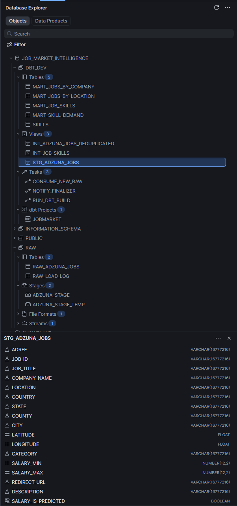
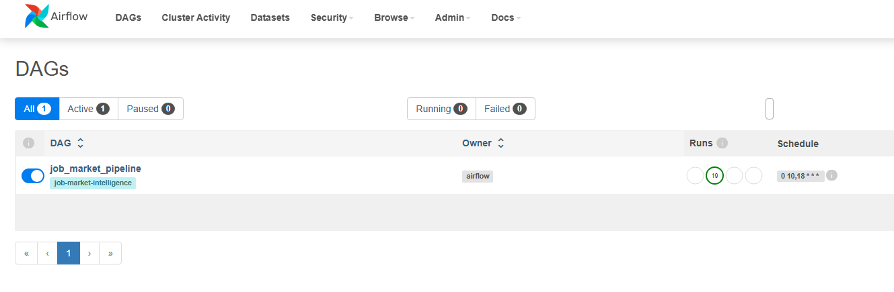
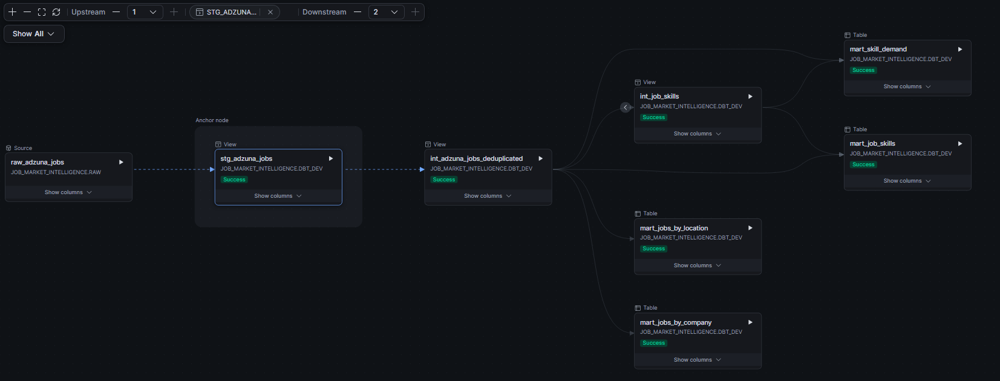
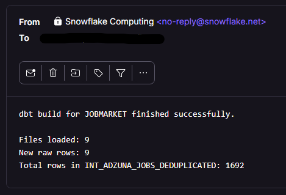
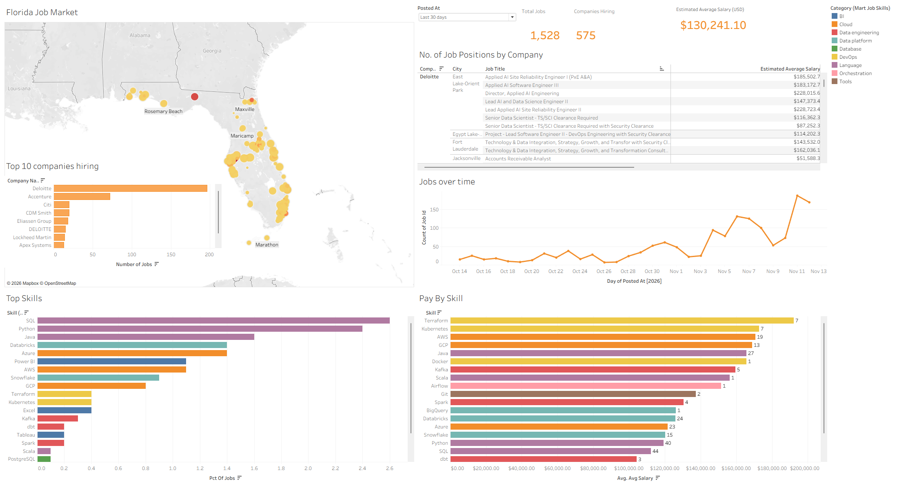
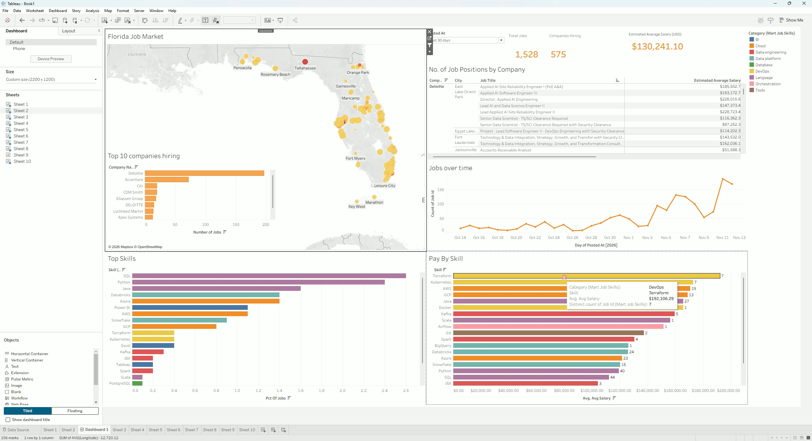

# ⊹ ࣪ ˖ Job Market Intelligence ⊹ ࣪ ˖

An automated data pipeline that collects Adzuna job postings, stores the raw data in Amazon S3, loads it into Snowflake, transforms it with dbt, and presents the results in Tableau.

## ✿ Architecture

```text
Adzuna Jobs API
      |
      v
Python ingestion task (Apache Airflow / Docker)
      |
      v
Amazon S3 (raw JSON)
      |
      v
Airflow COPY INTO task ---> Snowflake raw table
                                  |
                                  v
                          Snowflake stream/task
                                  |
                                  v
                         Root task
                    (new stream rows)
                                  |
                                  v
                         Child task
                           (dbt build)
                                  |
                                  v
                          Snowflake models
                         /          \
                        v            v
                Finalizer task   Tableau dashboards
                (email result)
```

Once configured, the pipeline runs automatically when the computer hosting Docker is on and the containers are running.

## ✿ Pipeline

1. **Fetch jobs:** The Python ingestion script calls the Adzuna Jobs API for Data Engineer postings in Florida. Airflow schedules the `job_market_pipeline` DAG at 10:00 and 18:00 daily (Airflow's configured timezone; UTC by default). Each run fetches up to 10 pages.
2. **Store raw data:** The ingestion task uploads each page as a JSON file to S3 under a date-partitioned `adzuna/ingestion_date=.../` path.
3. **Load Snowflake:** The following Airflow task runs `COPY INTO` to load files from the Snowflake stage into the raw jobs table.
4. **Transform and notify:** A Snowflake stream detects rows added by `COPY INTO`. The root task consumes/logs the stream, its child task runs `dbt build` for the Snowflake dbt project, and a finalizer task sends an email with the outcome and load summary.
5. **Explore:** Tableau connects to Snowflake to visualize the modeled job-market data.

The dbt project flattens the raw JSON, deduplicates postings, and builds marts for jobs by company, jobs by location, job skills, and skill demand. Staging and intermediate models are views; marts are tables.

## ✿ Analytics and skills

The Tableau dashboard filters postings to the **last 30 days** by default. It includes the top 10 hiring companies, total postings and companies hiring, a location map, posting trends over time, estimated average salary, salary by skill, and top skills.

Skills are identified by matching job descriptions against the dbt seed [`skills.csv`](dbt_job_market_intelligence/seeds/skills.csv). The seed maps skill names to categories (such as language, cloud, data engineering, BI, and databases) and matching patterns. The intermediate skill model uses those patterns to count job postings mentioning each skill.

## ✿ Cost and trial status

The project currently uses Adzuna's free API access, open-source Apache Airflow running locally in Docker, and free-trial or free-tier accounts for Snowflake, AWS, and Tableau. There is no managed Airflow service. Trial periods, quotas, and product terms vary, and AWS or Snowflake usage may incur charges if allowances are exceeded or a trial ends.

## ✿ Current limitations

- **Local orchestration:** Airflow runs in Docker on a local computer, so scheduled runs happen only while that computer is on and Docker is running.
- **S3-to-Snowflake credentials:** The intended secure AWS IAM role-based integration has not been configured successfully. The current external stage uses direct AWS credentials as a workaround; this is less secure and should be replaced with a Snowflake storage integration and an AWS IAM role.
- **Alternative ingestion:** Snowpipe with S3 event notifications could automatically ingest new files instead of relying on the scheduled Airflow `COPY INTO` task. It is not currently implemented and would still require working secure AWS/Snowflake integration.
- **Tableau publishing:** The dashboard is currently viewed in Tableau Desktop's free-trial setup. Publishing/sharing has not been verified and may require an eligible Tableau license; the image below is a local dashboard preview.
- **One-time setup:** Airflow connections, AWS access, the Snowflake stage/stream/task graph, and the Tableau connection must be configured before the automated flow can run.

## ✿ Run locally

### Prerequisites

- Docker Desktop
- Adzuna API credentials
- An AWS CLI profile named `job-market` with permission to write to the configured S3 bucket
- Snowflake key-pair authentication configured as the Airflow connection `snowflake_default`: the private key is mounted into the Airflow containers from the local Snowflake keys directory, and the matching public key is registered for the Snowflake user
- An Airflow Fernet key in `.env`, used by Airflow to encrypt stored connection and variable values
- The Snowflake raw table, stage, stream, dbt project, tasks, and email notification integration

The Compose setup reads secrets and local configuration from an ignored `.env` file and mounts the `job-market` AWS profile from your user AWS directory. Do not commit `.env` or paste credentials into SQL or source files.

### Start Airflow

```powershell
docker compose build
docker compose up airflow-init
docker compose up -d postgres airflow-webserver airflow-scheduler
```

Open the Airflow UI at [http://localhost:8080](http://localhost:8080). The DAG is named `job_market_pipeline`.

The Snowflake setup scripts are in [`sql/`](sql/). In particular, [`load_adzuna_raw.sql`](sql/load_adzuna_raw.sql) defines the raw load, [`s3_bucket_connection_v2.sql`](sql/s3_bucket_connection_v2.sql) documents the current temporary stage setup, and [`log_table_tasks.sql`](sql/log_table_tasks.sql) contains the stream/task and email-notification workflow. The exploratory `snowflake_sql_worksheet.sql` is not part of the production pipeline.

Thank you for checking out my project! . ۫ ·(˶˃ᆺ˂˶) ♡ ˎˊ˗

## ✿ Screenshots

### Snowflake Overview



### Airflow Pipeline



### dbt Model Lineage



### Email Notification



### Tableau Dashboard



### Tableau Demo

